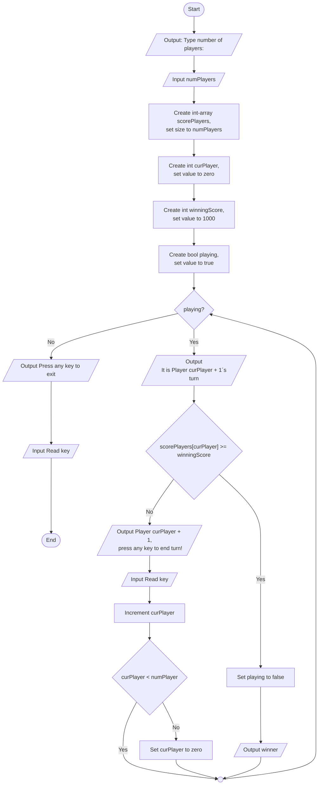

# Dice Game
Guide 1 - Players

## Overview
Flödeschemat visar en lösning för att inplemementera ett system som hantera ett godtyckligt antal spelare i ett tärningsspel. Systemet ska hålla reda på spelarnas poäng och växla spelare när deras runda är slut. Här finns också en lösning för att avgöra när en spelare har vunnit spelet, men än så länge delas inte några poäng ut. Det är först senare när poängsystemet är implementerat som vi kan testa logiken för att vinna spelet. Inplementation av poängsystemet kommer att ske i nästa guide.

### Features
* Välja antal spelare
* Struktur för att spara spelarnas poäng
* Avgöra om någon vunnit spelet
* Växla spelare när deras tur är slut

## Visuals

## Usage
Öppna projektet. Skriv kod som motsvarara flödesscemat för att implementera lösningen.

### Hints

* Noden *Input numPlayers* beskriver att programmet ska läsa in ett heltal som representerar antalet spelare, heltalet ska sparas i int variabeln *numPlayers*.
* Noden *Playing?* beskriver en while loop som ska fortsätta så länge som variabeln playing är *true*. När en spelare vinner spelet sätts playing till *false* och loopen avslutas.

Var nograna med att testa programet så ofta som möjligt för att se om det fungerar som förväntat.

## Known issues
* Det går inte att testa inpmplementationen av att vinna spelet eftersom poängsystemet inte är implementerat än. Det är först i nästa guide som poängsystemet implementeras.

## Authors
Alve Williamsson

