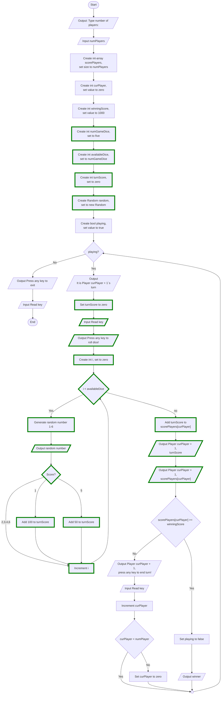

# Dice Game
Guide 2 - Roll Dice

## Overview
Flödesschemat visar en lösning för att implementera ett system som hantera tärningsslag och poängberäkning. Varje runda slås fem tärningar och poängen beräknas utifrån tärningarnas värden. En slagen etta ger 100 poäng och en femma ger 50 poäng. Alla andra tärningsvärden ger inga poäng. Poängen för rundan läggs till spelarens totala poäng och när en spelare når 1000 poäng vinner den spelaren spelet.

### Features
* Slå fem tärningar
* Ge spelaren poäng baserat på tärningarnas värden

## Visuals

## Usage
Utgå från er tidigare lösning och lägg till de nya funktionerna med hjälp av flödesschemat. 
* Nya noder är markerade med grön färg.

### Hints
* För att slå fem tärniningar används en for-loop. De tre noderna *Create i set to zero*, *i < numGameDice* och *Increment i* beskriver for-loopen.
* Noden *Generate random number 1-6* motsvarat ett tärningsslag. För att lösa det ska programmetgenerera ett slumptal mellan 1 och 6. Loppen upprepar sedan denna process fem gånger.
* Noden *Score?* beskriver de if-satser som avgör om tärningsslaget ger poäng eller inte. Om tärningen visar en etta läggs 100 poäng till turnScore och om tärningen visar en femma läggs 50 poäng till turnScore. För övriga resultat av tärnningsslaget behövs inga if-satser då de inte ger några poäng.

Testa programmet ofta för att se om det fungerar som förväntat.

## Known issues
* Om användaren matar in ett ogiltigt värde för antal spelare (t.ex. en sträng eller ett negativt tal) kommer programmet att krascha. 

## Authors
Alve Williamsson
