# Dice Game
Guid 4 - Available Dice

## Overview
Flödesschemat visar en lösning för att hantera fallet då en spelare får poäng på alla tärningar. Om det händer måste spelaren slå om alla tärningar. Om någon av tärningarna gav poäng kan spelaren välja att slå om de tärningar som inte gav poäng eller att spara poängen och avsluta sin tur. Om ingen av tärningarna i ett nytt slag gav poäng får spelaren noll poäng för hela rundan och turen går över till nästa spelare.

### Features
* Om en spelare får poäng på alla tärningar måste spelaren slå om alla tärningar.

## Visuals

```mermaid
graph TD

%% Start
Start([Start])-->OutNumPlayer[/Output: Type number of players:/]
OutNumPlayer-->InNumPlayers[/Input numPlayers/]
InNumPlayers-->CreatePlayers[Create int-array scorePlayers,<br/>set size to numPlayers]
CreatePlayers-->CreateCurrentPlayer[Create int curPlayer,<br/>set value to zero]
CreateCurrentPlayer-->CreateWinniongScore[Create int winningScore,<br/>set value to 1000]
CreateWinniongScore-->CreateGameDice[Create int numGameDice,<br/>set to five]
CreateGameDice-->CreateAvailableDice[Create int availableDice,<br/>set to numGameDice]
CreateAvailableDice-->CreateturnScore[Create int turnScore,<br/>set to zero]
CreateturnScore-->CreateRandom[Create Random random,<br/>set to new Random]
CreateRandom-->CreatePlaying[Create bool playing,<br/>set value to true]

%% Gameloop
CreatePlaying-->GameLoop{playing?}
GameLoop-- No -->GameOver[/Output Press any key to exit/]
GameOver-->EndGame[/Input Read key/]
EndGame-->End([End])
GameLoop-- Yes -->OutputPlayer[/Output<br/> It is Player curPlayer + 1´s turn/]
OutputPlayer-->ResetturnScore[Set turnScore to zero]
ResetturnScore-->ResetAvailableDice[Set availableDice to numGameDice]
ResetAvailableDice-->CreateTurnActive[Create bool turnActive,<br/>set value to true]
CreateTurnActive-->TurnLoop{turnActive?}


%% TurnLoop
RollLoop-- no -->Out[/Output Player curPlayer + 1<br/>rollScore/]
Out-->RollScoreGZero{rollScore > 0}
RollScoreGZero-- Yes -->RollToTurnScore[Add rollScore to turnScore]
RollToTurnScore-->OTurnScore[/Output Player curPlayer + 1,<br/>turnScore/]
OTurnScore-->SubDice[Subtract scoreDice<br/> from availableDice]
SubDice-->AvailableDiceZero{availableDice <= 0}
AvailableDiceZero-- Yes -->ReAvailableDice[Set availableDice to numGameDice]
ReAvailableDice-->OutReroll[/"Output Player curPlayer + 1,<br/>availableDice",<br/> score on all dice!/]
OutReroll-->OutputRollScore[/"Output Player curPlayer + 1,<br/> scorePlayers[curPlayer]"/]
AvailableDiceZero-- No -->OutTurn[/"Output Player curPlayer + 1,<br/>availableDice,<br/> Roll Again?"/]
OutTurn-->RollAgain{RollAgain?}
RollScoreGZero-- No -->TurnScoreZero[Set turnScore to zero]
TurnScoreZero-->RAvailableDice[Set availableDice to numGameDice]
RAvailableDice-->NoScore[/Output Player curPlayer + 1<br/>turn score is zero!/]
NoScore-->TurnLoopFalse[Set turnActive to false]
RollAgain-- Yes -->OutputRollScore
TurnLoopFalse-->OutputRollScore
RollAgain-- No -->TurnToPlayerScore["Add turnScore to<br/>scorePlayers[curPlayer]"]
TurnToPlayerScore-->TurnLoopFalse
OutputRollScore-->TurnLoop

%% RollLoop
TurnLoop-- Yes -->PressToRoll[/"Output Press any key to roll dice!"/]
PressToRoll-->InKeyRoll[/Input Read key/]
InKeyRoll-->CreateRollScore[Create int rollScore,<br/>set value to zero]
CreateRollScore[Create int rollScore,<br/>set value to zero]
CreateRollScore-->CreateScoreDice[Create int scoreDice,<br/>set value to zero]
CreateScoreDice-->CreateI[Create int i, set to zero]
CreateI-->RollLoop{i < availableDice}
RollLoop-- Yes -->Roll[Generate random number 1-6]
Roll-->OutNumber[/Output random number/]
OutNumber-->Score{Score?}
Score-- 1 -->One[Add 100 to rollScore]
Score-- 5 -->Five[Add 50 to rollScore]
Score-- 2,3,4,6 -->IncrementI[Increment i]
One & Five -->IncrementScoreDice[Increment scoreDice]
IncrementScoreDice-->IncrementI
IncrementI -->RollLoop

%% Change player
TurnLoop-- No -->DecideWinner{"scorePlayers[curPlayer] >= winningScore"}
DecideWinner-- No -->TurnOver[/"Output Player curPlayer + 1,<br/>, press any key to end turn!"/]
TurnOver-->InKey2[/Input Read key/]
InKey2-->IncrementPlayer[Increment curPlayer]
IncrementPlayer-->ChangePlayer{curPlayer < numPlayer}
ChangePlayer-- Yes -->GameLoopConector(( ))
ChangePlayer-- No -->ResetPlayer[Set curPlayer to zero]

%% Win
DecideWinner-- Yes -->PlayingFalse[Set playing to false]
PlayingFalse-->Winner[/Output winner/]
ResetPlayer-->GameLoopConector
GameLoopConector-->GameLoop
Winner-->GameLoopConector

classDef NewNode stroke:green,stroke-width:5px
classDef ModNode stroke:blue,stroke-width:5px
classDef MovedNode stroke:purple,stroke-width:5px

class AvailableDiceZero,ReAvailableDice,OutReroll NewNode

%% class One,Five ModNode

%% class OTurnScore,OutputRollScore,TurnToPlayerScore MovedNode
```

## Usage
Utgå från er tidigare lösning och lägg till de nya funktionerna med hjälp av flödesschemat. 
* Nya noder är markerade med grön färg.

### Tip
* Om en spelare får poäng på alla tärningar ska spelaren inte få välja att spara poängen och avsluta sin tur, spelaren måste i det fallet slå om alla tärningar.
* Viktigt att återställa antalet tillgänliga tärningar när en spelare får poäng på alla tärningar.

Testa programmet ofta för att se om det fungerar som förväntat.

## Known issues
* Om användaren matar in ett ogiltigt värde för antal spelare (t.ex. en sträng eller ett negativt tal) kommer programmet att krascha. 

## Authors
Alve Williamsson
