# Dice Game - Guid 5
Guid för implementation av lösning för att fortsätt vidare med föregående spelares poäng i tärningsspelet

## Overview
Flödesschemat visar en lösning för att implementera ett system för att ge en spelare möjlighet att behålla poängen från föregående spelare. Om en spelare sparar poäng i slutet av sin runda får nästa spelare möjlighet att fortsätta med samma antal poäng och tärningar. Om spelaren väljer att inte fortsätta så börjar rundan med noll poäng och fem tärningar som vanligt.

### Features
* Spelaren får mölighet att spela vidare på föregående spelares poäng och antal tärningar.

## Visuals

```mermaid
graph TD

%% Start
Start([Start])-->OutNumPlayer[/Output: Type number of players:/]
OutNumPlayer-->InNumPlayers[/Input numPlayers/]
InNumPlayers-->CreatePlayers[Create int-array scorePlayers,<br/>set size to numPlayers]
CreatePlayers-->CreateCurrentPlayer[Create int curPlayer,<br/>set value to zero]
CreateCurrentPlayer-->CreateWinniongScore[Create int winningScore,<br/>set value to 1000]
CreateWinniongScore-->CreateGameDice[Create int numGameDice,<br/>set to five]
CreateGameDice-->CreateAvailableDice[Create int availableDice,<br/>set to numGameDice]
CreateAvailableDice-->CreateturnScore[Create int turnScore,<br/>set to zero]
CreateturnScore-->CreateRandom[Create Random random,<br/>set to new Random]
CreateRandom-->CreatePlaying[Create bool playing,<br/>set value to true]

%% Gameloop
CreatePlaying-->GameLoop{playing?}
GameLoop-- No -->GameOver[/Output Press any key to exit/]
GameOver-->EndGame[/Input Read key/]
EndGame-->End([End])
GameLoop-- Yes -->OutputPlayer[/Output<br/> It is Player curPlayer + 1´s turn/]
OutputPlayer-->OutPrevTurnScore[/Output<br/>Score from previous player:<br/>turnScore<br/>Available dice: availableDice/]
OutPrevTurnScore-->IsTurnScoreGZero{turnScore > 0}
IsTurnScoreGZero-- Yes -->KeepTurnScore[/Output<br/>Keep score and available dice<br/>from previous player?/]
KeepTurnScore-->Keep{Keep?}
IsTurnScoreGZero-- No -->CreateTurnActive[Create bool turnActive,<br/>set value to true]
Keep-- Yes -->CreateTurnActive
Keep-- No -->ResetTurnScore[Set turnScore to zero]
ResetTurnScore-->ResetAvailableDice[Set availableDice to numGameDice]
ResetAvailableDice-->CreateTurnActive
CreateTurnActive-->TurnLoop{turnActive?}


%% TurnLoop
RollLoop-- no -->Out[/Output Player curPlayer + 1<br/>rollScore/]
Out-->RollScoreGZero{rollScore > 0}
RollScoreGZero-- Yes -->RollToTurnScore[Add rollScore to turnScore]
RollToTurnScore-->OTurnScore[/Output Player curPlayer + 1,<br/>turnScore/]
OTurnScore-->AvailableDiceZero{availableDice <= 0}
AvailableDiceZero-- Yes -->ReAvailableDice[Set availableDice to numGameDice]
ReAvailableDice-->OutReroll[/"Output Player curPlayer + 1,<br/>availableDice",<br/> score on all dice!/]
OutReroll-->OutputRollScore[/"Output Player curPlayer + 1,<br/> scorePlayers[curPlayer]"/]
AvailableDiceZero-- No -->OutTurn[/"Output Player curPlayer + 1,<br/>availableDice,<br/> Roll Again?"/]
OutTurn-->RollAgain{RollAgain?}
RollScoreGZero-- No -->TurnScoreZero[Set turnScore to zero]
TurnScoreZero-->RAvailableDice[Set availableDice to numGameDice]
RAvailableDice-->NoScore[/Output Player curPlayer + 1<br/>turn score is zero!/]
NoScore-->TurnLoopFalse[Set turnActive to false]
RollAgain-- Yes -->OutputRollScore
TurnLoopFalse-->OutputRollScore
RollAgain-- No -->TurnToPlayerScore["Add turnScore to<br/>scorePlayers[curPlayer]"]
TurnToPlayerScore-->TurnLoopFalse
OutputRollScore-->TurnLoop

%% RollLoop
TurnLoop-- Yes -->PressToRoll[/"Output Press any key to roll dice!"/]
PressToRoll-->InKeyRoll[/Input Read key/]
InKeyRoll-->CreateRollScore[Create int rollScore,<br/>set value to zero]
CreateRollScore[Create int rollScore,<br/>set value to zero]
CreateRollScore-->CreateI[Create int i, set to zero]
CreateI-->RollLoop{i < availableDice}
RollLoop-- Yes -->Roll[Generate randomNumber 1-6]
Roll-->OutNumber[/Output randomNumber/]
OutNumber-->Score{Score?}
Score-- 1 -->One[Add 100 to rollScore]
Score-- 5 -->Five[Add 50 to rollScore]
Score-- 2,3,4,6 -->IncrementI[Increment i]
One & Five -->DecrementAvailable[Decrement availableDice]
DecrementAvailable-->IncrementI
IncrementI -->RollLoop

%% Change player
TurnLoop-- No -->DecideWinner{"scorePlayers[curPlayer] >= winningScore"}
DecideWinner-- No -->TurnOver[/"Output Player curPlayer + 1,<br/>, press any key to end turn!"/]
TurnOver-->InKey2[/Input Read key/]
InKey2-->IncrementPlayer[Increment curPlayer]
IncrementPlayer-->ChangePlayer{curPlayer < numPlayer}
ChangePlayer-- Yes -->GameLoopConector((( )))
ChangePlayer-- No -->ResetPlayer[Set curPlayer to zero]

%% Win
DecideWinner-- Yes -->PlayingFalse[Set playing to false]
PlayingFalse-->Winner[/Output winner/]
ResetPlayer-->GameLoopConector
GameLoopConector-->GameLoop
Winner-->GameLoopConector

classDef newNode stroke:green,stroke-width:5px
classDef modNode stroke:blue,stroke-width:5px

class OutPrevTurnScore,IsTurnScoreGZero,KeepTurnScore,Keep newNode

%%class  modNode

```

## Usage
Utgå från er tidigare lösning och lägg till de nya funktionerna med hjälp av flödesschemat. 
* Nya noder är markerade med grön färg.

### Tip
Glöm inte att harera antalet tillgängliga tärningar. 
* Om spelaren väljer att fortsätta med poängen från föregående runda så ska spelaren ha samma antal tillgängliga tärningar som förra spelaren hade när den rundan avslutades. 
* Om spelaren inte vill fortsätta med poängen från föregående runda så ska poängen sättas till noll och antalet tillgängliga tärningar till fem.

## Known issues
* Om användaren matar in ett ogiltigt värde för antal spelare (t.ex. en sträng eller ett negativt tal) kommer programmet att krascha. 

## Authors
Alve Williamsson
