# Dice Game - Guid 6
Guid för implementation av lösning för hantera triss i tärningsspelet

## Overview
Flödesschemat visar en lösning för att hantera triss i tärningsspelet.

| Triss i: | Poäng |
|---|---|
| 1 | 1000 | 
| 2 | 200 | 
| 3 | 300 | 
| 4 | 400 | 
| 5 | 500 | 
| 6 | 600 | 

### Features
* Poäng för triss

## Visuals

```mermaid
graph TD

%% Start
Start([Start])-->OutNumPlayer[/Output: Type number of players:/]
OutNumPlayer-->InNumPlayers[/Input numPlayers/]
InNumPlayers-->CreatePlayers[Create int-array scorePlayers,<br/>set size to numPlayers]
CreatePlayers-->CreateCurrentPlayer[Create int curPlayer,<br/>set value to zero]
CreateCurrentPlayer-->CreateWinningScore[Create int winningScore,<br/>set value to 1000]
CreateWinningScore-->CreateGameDice[Create int numGameDice,<br/>set to five]
CreateGameDice-->CreateAvailableDice[Create int availableDice,<br/>set to numGameDice]
CreateAvailableDice-->CreateTurnScore[Create int turnScore,<br/>set to zero]
CreateTurnScore-->CreateRandom[Create Random random,<br/>set to new Random]
CreateRandom-->CreatePlaying[Create bool playing,<br/>set value to true]

%% Game loop
CreatePlaying-->GameLoop{playing?}
GameLoop-- No -->GameOver[/Output Press any key to exit/]
GameOver-->EndGame[/Input Read key/]
EndGame-->End([End])
GameLoop-- Yes -->OutputPlayer[/Output<br/> It is Player curPlayer + 1´s turn/]
OutputPlayer-->OutPrevTurnScore[/Output<br/>Score from previous player:<br/>turnScore<br/>Available dice: availableDice/]
OutPrevTurnScore-->IsTurnScoreGZero{turnScore > 0}
IsTurnScoreGZero-- Yes -->KeepTurnScore[/Output<br/>Keep score and available dice<br/>from previous player?/]
KeepTurnScore-->Keep{Keep?}
IsTurnScoreGZero-- No -->CreateTurnActive[Create bool turnActive,<br/>set value to true]
Keep-- Yes -->CreateTurnActive
Keep-- No -->ResetTurnScore[Set turnScore to zero]
ResetTurnScore-->ResetAvailableDice[Set availableDice to numGameDice]
ResetAvailableDice-->CreateTurnActive
CreateTurnActive-->TurnLoop{turnActive?}


%% ScoreLoop
RollLoop-- no -->CreateILoop[Create i,<br/>set to zero]
CreateILoop-->ScoreLoop{i < numGameDice}
ScoreLoop-- NO -->Out[/Output Player curPlayer + 1<br/>rollScore/]

ScoreLoop-- Yes -->IsTriplet{"diceRolls[i] >= 3"}
IsTriplet-- Yes -->CreateMultiplier[Create int multiplier,<br/>set to 100]
CreateMultiplier-->IsOne{i == 1}
IsOne-- Yes -->ChangeMultiplier[Set multiplier to 1000]
ChangeMultiplier-->TripletScore[Add i*multiplier to rollScore]
IsOne-- No -->TripletScore
TripletScore-->SubRollDice["Subtract three from diceRolls[i]"]
SubRollDice-->Sub3Available[Subtract three from availableDice]
Sub3Available-->AddOne["Add 100*diceRolls[1] to rollScore"]
AddOne-->ScoreOne["Subtract diceRolls[1] from availableDice"]
ScoreOne-->AddFive["Add 50*diceRolls[5] to rollScore"]
AddFive-->ScoreFive["Subtract diceRolls[5] from availableDice"]
ScoreFive-->InI[Increment i]
IsTriplet-- No -->AddOne
InI-->ScoreLoop

%% TurnLoop
Out-->RollScoreGZero{rollScore > 0}
RollScoreGZero-- Yes -->RollToTurnScore[Add rollScore to turnScore]
RollToTurnScore-->OTurnScore[/Output Player curPlayer + 1,<br/>turnScore/]
OTurnScore-->AvailableDiceZero{availableDice <= 0}
AvailableDiceZero-- Yes -->ReAvailableDice[Set availableDice to numGameDice]
ReAvailableDice-->OutReroll[/"Output Player curPlayer + 1,<br/>availableDice",<br/> score on all dice!/]
OutReroll-->OutputRollScore[/"Output Player curPlayer + 1,<br/> scorePlayers[curPlayer]"/]
AvailableDiceZero-- No -->OutTurn[/"Output Player curPlayer + 1,<br/>availableDice,<br/> Roll Again?"/]
OutTurn-->Answer[/Input Answer/]
Answer-->RollAgain{RollAgain?}
RollScoreGZero-- No -->TurnScoreZero[Set turnScore to zero]
TurnScoreZero-->RAvailableDice[Set availableDice to numGameDice]
RAvailableDice-->NoScore[/Output Player curPlayer + 1<br/>turn score is zero!/]
NoScore-->TurnLoopFalse[Set turnActive to false]
RollAgain-- Yes -->OutputRollScore
TurnLoopFalse-->OutputRollScore
RollAgain-- No -->TurnToPlayerScore["Add turnScore to<br/>scorePlayers[curPlayer]"]
TurnToPlayerScore-->TurnLoopFalse
OutputRollScore-->TurnLoop

%% RollLoop
TurnLoop-- Yes -->PressToRoll[/"Output Press any key to roll dice!"/]
PressToRoll-->InKeyRoll[/Input Read key/]
InKeyRoll-->CreateRollScore[Create int rollScore,<br/>set value to zero]
CreateRollScore[Create int rollScore,<br/>set value to zero]
CreateRollScore-->CreateDiceRolls[Create int array diceRolls,<br/>set size to 7]
CreateDiceRolls-->CreateI[Create int i, set to zero]
CreateI-->RollLoop{i < availableDice}
RollLoop-- Yes -->Roll[Generate int randomNumber 1-6]
Roll-->AddToList["Increment diceRolls[randomNumber]"]
AddToList-->OutNumber[/Output randomNumber/]
OutNumber-->IncrementI[Increment i]
IncrementI -->RollLoop

%% Change player
TurnLoop-- No -->DecideWinner{"scorePlayers[curPlayer] >= winningScore"}
DecideWinner-- No -->TurnOver[/"Output Player curPlayer + 1,<br/>, press any key to end turn!"/]
TurnOver-->InKey2[/Input Read key/]
InKey2-->IncrementPlayer[Increment curPlayer]
IncrementPlayer-->ChangePlayer{curPlayer < numPlayer}
ChangePlayer-- Yes -->GameLoopConnector((( )))
ChangePlayer-- No -->ResetPlayer[Set curPlayer to zero]

%% Win
DecideWinner-- Yes -->PlayingFalse[Set playing to false]
PlayingFalse-->Winner[/Output winner/]
ResetPlayer-->GameLoopConnector
GameLoopConnector-->GameLoop
Winner-->GameLoopConnector

classDef newNode stroke:green,stroke-width:5px
classDef modNode stroke:blue,stroke-width:5px

class CreateDiceRolls,AddToList,CreateILoop,ScoreLoop,IsTriplet,CreateMultiplier,IsOne,ChangeMultiplier,TripletScore,SubRollDice,Sub3Available,ScoreOne,ScoreFive newNode

class AddOne,AddFive modNode

```

## Usage
Utgå från er tidigare lösning och lägg till de nya funktionerna med hjälp av flödesschemat. 
* Nya noder är markerade med grön färg.
* Modifierade noder är markerade med blå färg.

### Tip
* För att hålla koll på hur många tärningar som visar ett visst värde gör vi en array med sju platser. Index för listan motsvara tärningens värde. För varje slagen tärning använder vi tärningens värde som index i listan och adderar 1 på den platsen. Index noll i listan kommer inte att användas.
* Vi kan loopa igenom listan och kolla om någon plats har värde 3 eller större, i sådana fall har vi hittat en triss. 
Vär vi delar ut poäng för en triss får vi inte glömma att ta subtrahera *availableDice* och värdet på den platsen i listan med tre.
* Efter vi kollat triss kan vi kolla hur många ettor och femmor som finns i listan.  
* Om trissen är i ettor eller femmor så ska spelaren inte få de vanliga 50/100 poängen för tärningarna.

Exempel:  
Tärningsslag: 6, 4, 4, 5 4

| Index | Värde |
|---|---|
| 0 | 0 | 
| 1 | 0 | 
| 2 | 0 | 
| 3 | 0 | 
| 4 | 3 | 
| 5 | 1 | 
| 6 | 1 | 

## Known issues
* Om användaren matar in ett ogiltigt värde för antal spelare (t.ex. en sträng eller ett negativt tal) kommer programmet att krascha. 

## Authors
Alve Williamsson
