# Dice Game - Guid 6
Guid för implementation av lösning för hantera triss i tärningsspelet

## Overview
Flödesschemat visar en lösning för hantera triss i tärningsspelet.

### Features
* Poäng för triss

## Visuals

```mermaid
graph TD

%% Start
Start([Start])-->OutNumPlayer[/Output: Type number of players:/]
OutNumPlayer-->InNumPlayers[/Input numPlayers/]
InNumPlayers-->CreatePlayers[Create int-array scorePlayers,<br/>set size to numPlayers]
CreatePlayers-->CreateCurrentPlayer[Create int curPlayer,<br/>set value to zero]
CreateCurrentPlayer-->CreateWinniongScore[Create int winningScore,<br/>set value to 1000]
CreateWinniongScore-->CreateGameDice[Create int numGameDice,<br/>set to five]
CreateGameDice-->CreateAvailableDice[Create int availableDice,<br/>set to numGameDice]
CreateAvailableDice-->CreateturnScore[Create int turnScore,<br/>set to zero]
CreateturnScore-->CreateRandom[Create Random random,<br/>set to new Random]
CreateRandom-->CreatePlaying[Create bool playing,<br/>set value to true]

%% Gameloop
CreatePlaying-->GameLoop{playing?}
GameLoop-- No -->GameOver[/Output Press any key to exit/]
GameOver-->EndGame[/Input Read key/]
EndGame-->End([End])
GameLoop-- Yes -->OutputPlayer[/Output<br/> It is Player curPlayer + 1´s turn/]
OutputPlayer-->OutPrevTurnScore[/Output<br/>Score from previous player:<br/>turnScore<br/>Available dice: availableDice/]
OutPrevTurnScore-->IsTurnScoreGZero{turnScore > 0}
IsTurnScoreGZero-- Yes -->KeepTurnScore[/Output<br/>Keep score and available dice<br/>from previous player?/]
KeepTurnScore-->Keep{Keep?}
IsTurnScoreGZero-- No -->CreateTurnActive[Create bool turnActive,<br/>set value to true]
Keep-- Yes -->CreateTurnActive
Keep-- No -->ResetTurnScore[Set turnScore to zero]
ResetTurnScore-->ResetAvailableDice[Set availableDice to numGameDice]
ResetAvailableDice-->CreateTurnActive
CreateTurnActive-->TurnLoop{turnActive?}


%% ScoreLoop
RollLoop-- no -->CreateILoop[Create i,<br/>set to zero]
CreateILoop-->ScoreLoop{i < numGameDice}
ScoreLoop-->AddOne["Add 100*diceRolls[1] to rollScore"]
AddOne-->ScoreOne["Subtract diceRolls[1] from availableDice"]
ScoreOne-->AddFive["Add 50*diceRolls[5] to rollScore"]
AddFive-->ScoreFive["Subtract diceRolls[5] from availableDice"]
ScoreFive-->Out[/Output Player curPlayer + 1<br/>rollScore/]

ScoreLoop-->IsTriplet{"diceRolls[i] >= 3"}
IsTriplet-- Yes -->TripletScore[Add i*100 to rollscore]
TripletScore-->SubRollDice["Subtract three from diceRolls[i]"]
SubRollDice-->Sub3Available[Subtract three from availableDice]
Sub3Available-->InI
IsTriplet-- No -->InI[Increment i]
InI-->ScoreLoop

%% TurnLoop
Out-->RollScoreGZero{rollScore > 0}
RollScoreGZero-- Yes -->RollToTurnScore[Add rollScore to turnScore]
RollToTurnScore-->OTurnScore[/Output Player curPlayer + 1,<br/>turnScore/]
OTurnScore-->AvailableDiceZero{availableDice <= 0}
AvailableDiceZero-- Yes -->ReAvailableDice[Set availableDice to numGameDice]
ReAvailableDice-->OutReroll[/"Output Player curPlayer + 1,<br/>availableDice",<br/> score on all dice!/]
OutReroll-->OutputRollScore[/"Output Player curPlayer + 1,<br/> scorePlayers[curPlayer]"/]
AvailableDiceZero-- No -->OutTurn[/"Output Player curPlayer + 1,<br/>availableDice,<br/> Roll Again?"/]
OutTurn-->RollAgain{RollAgain?}
RollScoreGZero-- No -->TurnScoreZero[Set turnScore to zero]
TurnScoreZero-->RAvailableDice[Set availableDice to numGameDice]
RAvailableDice-->NoScore[/Output Player curPlayer + 1<br/>turn score is zero!/]
NoScore-->TurnLoopFalse[Set turnActive to false]
RollAgain-- Yes -->OutputRollScore
TurnLoopFalse-->OutputRollScore
RollAgain-- No -->TurnToPlayerScore["Add turnScore to<br/>scorePlayers[curPlayer]"]
TurnToPlayerScore-->TurnLoopFalse
OutputRollScore-->TurnLoop

%% RollLoop
TurnLoop-- Yes -->PressToRoll[/"Output Press any key to roll dice!"/]
PressToRoll-->InKeyRoll[/Input Read key/]
InKeyRoll-->CreateRollScore[Create int rollScore,<br/>set value to zero]
CreateRollScore[Create int rollScore,<br/>set value to zero]
CreateRollScore-->CreateDiceRolls[Create int array diceRolls,<br/>set size to numGameDice]
CreateDiceRolls-->CreateI[Create int i, set to zero]
CreateI-->RollLoop{i < availableDice}
RollLoop-- Yes -->Roll[Generate int randomNumber 1-6]
Roll-->AddToList["Increment diceRolls[randomNumber]"]
AddToList-->OutNumber[/Output randomNumber/]
OutNumber-->IncrementI[Increment i]
IncrementI -->RollLoop

%% Change player
TurnLoop-- No -->DecideWinner{"scorePlayers[curPlayer] >= winningScore"}
DecideWinner-- No -->TurnOver[/"Output Player curPlayer + 1,<br/>, press any key to end turn!"/]
TurnOver-->InKey2[/Input Read key/]
InKey2-->IncrementPlayer[Increment curPlayer]
IncrementPlayer-->ChangePlayer{curPlayer < numPlayer}
ChangePlayer-- Yes -->GameLoopConector((( )))
ChangePlayer-- No -->ResetPlayer[Set curPlayer to zero]

%% Win
DecideWinner-- Yes -->PlayingFalse[Set playing to false]
PlayingFalse-->Winner[/Output winner/]
ResetPlayer-->GameLoopConector
GameLoopConector-->GameLoop
Winner-->GameLoopConector

classDef newNode stroke:green,stroke-width:5px
classDef modNode stroke:blue,stroke-width:5px

%%class OutPrevTurnScore,IsTurnScoreGZero,KeepTurnScore,Keep newNode

%%class  modNode

```

## Usage
Utgå från er tidigare lösning och lägg till de nya funktionerna med hjälp av flödesschemat. 
* Nya noder är markerade med grön färg.

### Tip
Glöm inte att harera antalet tillgängliga tärningar. 
* Skapa en int-array och döp den till *diceRolls* och sätt storeken till 5.
* När en tärning slås lägger ni till den i *diceRolls* istället för att lägga till poäng. Genom att adera ett på platsen i *diceRolls* som tärningen visar kan vi räkna hur många tärningar som fått ett visst värde.
* Loopa sedan igenom *diceRolls* för att leta efter triss!
* Addera poängern för trissen till *rollScore*, subtrahera sedan tre från respektive plats i *diceRolls*.
* Efter loopen aderar ni poängen för ettor och femor till *rollScore*. 

Gör en ny loop efter loopen som slår tärningarna

## Known issues
* Om användaren matar in ett ogiltigt värde för antal spelare (t.ex. en sträng eller ett negativt tal) kommer programmet att krascha. 

## Authors
Alve Williamsson
