# Dice Game - Guid 7
Guid för implementation av lösning för Välja vilka poäng som ska sparas i tärningsspelet

## Overview
Spelaren ska få möjlighet att välja vilka poäng som ska sparas efter ett tärningsslag. För triss måste alla tre tärningar sparas, för ettor och femmor görs valet för varje individuell tärning. Spelare måste spara minst ett sett av poänggivande tärningar, om inga tärningar sparas får spelaren ett nytt försök att spara poäng. Processen tills spelaren har valt att spara något sätt av poänggivande tärningar.

### Features
* Välja vilka sett av poänggivande tärningar som ska sparas efter ett tärningsslag.

## Visuals

```mermaid
graph TD

%% Start
Start([Start])-->OutNumPlayer[/Output: Type number of players:/]
OutNumPlayer-->InNumPlayers[/Input numPlayers/]
InNumPlayers-->CreatePlayers[Create int-array scorePlayers,<br/>set size to numPlayers]
CreatePlayers-->CreateCurrentPlayer[Create int curPlayer,<br/>set value to zero]
CreateCurrentPlayer-->CreateWinningScore[Create int winningScore,<br/>set value to 1000]
CreateWinningScore-->CreateGameDice[Create int numGameDice,<br/>set to five]
CreateGameDice-->CreateAvailableDice[Create int availableDice,<br/>set to numGameDice]
CreateAvailableDice-->CreateTurnScore[Create int turnScore,<br/>set to zero]
CreateTurnScore-->CreateRandom[Create Random random,<br/>set to new Random]
CreateRandom-->CreatePlaying[Create bool playing,<br/>set value to true]

%% Game loop
CreatePlaying-->GameLoop{playing?}
GameLoop-- No -->GameOver[/Output Press any key to exit/]
GameOver-->EndGame[/Input Read key/]
EndGame-->End([End])
GameLoop-- Yes -->OutputPlayer[/Output<br/> It is Player curPlayer + 1´s turn/]
OutputPlayer-->OutPrevTurnScore[/Output<br/>Score from previous player:<br/>turnScore<br/>Available dice: availableDice/]
OutPrevTurnScore-->IsTurnScoreGZero{turnScore > 0}
IsTurnScoreGZero-- Yes -->KeepTurnScore[/Output<br/>Keep score and available dice<br/>from previous player?/]
KeepTurnScore-->Keep{Keep?}
IsTurnScoreGZero-- No -->CreateTurnActive[Create bool turnActive,<br/>set value to true]
Keep-- Yes -->CreateTurnActive
Keep-- No -->ResetTurnScore[Set turnScore to zero]
ResetTurnScore-->ResetAvailableDice[Set availableDice to numGameDice]
ResetAvailableDice-->CreateTurnActive
CreateTurnActive-->TurnLoop{turnActive?}

%% SaveLoop
RollLoop-- no -->CreateSaveActive[Create bool saveActive,<br/>set value to true]
CreateSaveActive-->SaveLoop{saveActive?}


%% ScoreLoop

SaveLoop-- Yes -->CreateScoreCounter[Create int scoreCounter,<br/>set value to zero]
CreateScoreCounter-->CreateILoop[Create i,<br/>set to one]
CreateILoop-->ScoreLoop{i < diceRolls.length}
SaveLoop-- No -->SubAv[Subtract scoreDice from availableDice]

SubAv-->Out[/Output Player curPlayer + 1<br/>rollScore/]

ScoreLoop-- Yes -->CreateMultiplier[Create int multiplier,<br/>set to 1]
ScoreLoop-- No -->EndSaveLoop{scoreCounter == 0</br>or rollScore > 0}
EndSaveLoop-- Yes -->SaveLoopFalse[Set saveActive to false]
EndSaveLoop-- No -->OutSaveNeeded[/Output You need to save</br>at least one score die!/]
OutSaveNeeded-->ScoreConnector((( )))
SaveLoopFalse-->ScoreConnector
ScoreConnector-->SaveLoop
CreateMultiplier-->IsOne{i == 1}
IsOne-- Yes -->ChangeMultiplier[Set multiplier to 10]
ChangeMultiplier-->IsTriplet{"diceRolls[i] >= 3"}
IsTriplet-- Yes -->TripletScoreCounter[Increment scoreCounter]
TripletScoreCounter-->OutSaveTriplets[/Output Save triplets?/]
OutSaveTriplets-->InSaveTriplets[/Input Answer/]
InSaveTriplets-->SaveTriplets{Save triplets?}
SaveTriplets-- Yes -->TripletScore[Add i*100*multiplier to rollScore]
SaveTriplets-- No -->InI[Increment i]
IsOne-- No -->IsTriplet
TripletScore-->Add3ScoreDice[Add three to scoreDice]
Add3ScoreDice-->InI
IsTriplet-- No -->IsOneOrFive{"i == 1 or i == 5"}
IsOneOrFive-- Yes -->OneFiveScoreCounter[Increment scoreCounter]
OneFiveScoreCounter-->OutOneFiveSave[/Output Save score?/]
OutOneFiveSave-->InOneFiveSave[/Input Answer/]
InOneFiveSave-->SaveOneFive{Save score?}
SaveOneFive-- Yes -->AddOne["Add i*10*multiplier*diceRolls[i] to rollScore"]
SaveOneFive-- No -->InI
AddOne-->ScoreOne["Add diceRolls[i] to scoreDice"]
ScoreOne-->InI
IsOneOrFive-- No -->InI
InI-->ScoreLoop

%% TurnLoop
Out-->RollScoreGZero{rollScore > 0}
RollScoreGZero-- Yes -->RollToTurnScore[Add rollScore to turnScore]
RollToTurnScore-->OTurnScore[/Output Player curPlayer + 1,<br/>turnScore/]
OTurnScore-->AvailableDiceZero{availableDice <= 0}
AvailableDiceZero-- Yes -->ReAvailableDice[Set availableDice to numGameDice]
ReAvailableDice-->OutReroll[/"Output Player curPlayer + 1,<br/>availableDice",<br/> score on all dice!/]
OutReroll-->OutputRollScore[/"Output Player curPlayer + 1,<br/> scorePlayers[curPlayer]"/]
AvailableDiceZero-- No -->OutTurn[/"Output Player curPlayer + 1,<br/>availableDice,<br/> Roll Again?"/]
OutTurn-->Answer[/Input Answer/]
Answer-->RollAgain{RollAgain?}
RollScoreGZero-- No -->TurnScoreZero[Set turnScore to zero]
TurnScoreZero-->RAvailableDice[Set availableDice to numGameDice]
RAvailableDice-->NoScore[/Output Player curPlayer + 1<br/>turn score is zero!/]
NoScore-->TurnLoopFalse[Set turnActive to false]
RollAgain-- Yes -->OutputRollScore
TurnLoopFalse-->OutputRollScore
RollAgain-- No -->TurnToPlayerScore["Add turnScore to<br/>scorePlayers[curPlayer]"]
TurnToPlayerScore-->TurnLoopFalse
OutputRollScore-->TurnLoop

%% RollLoop
TurnLoop-- Yes -->PressToRoll[/"Output Press any key to roll dice!"/]
PressToRoll-->InKeyRoll[/Input Read key/]
InKeyRoll-->CreateRollScore[Create int rollScore,<br/>set value to zero]
CreateRollScore-->CreateDiceRolls[Create int array diceRolls,<br/>set size to 7]
CreateDiceRolls-->CreateScoreDice[Create scoreDice,<br/>set to zero]
CreateScoreDice-->CreateI[Create int i, set to zero]
CreateI-->RollLoop{i < availableDice}
RollLoop-- Yes -->Roll[Generate int randomNumber 1-6]
Roll-->AddToList["Increment diceRolls[randomNumber]"]
AddToList-->OutNumber[/Output randomNumber/]
OutNumber-->IncrementI[Increment i]
IncrementI -->RollLoop

%% Change player
TurnLoop-- No -->DecideWinner{"scorePlayers[curPlayer] >= winningScore"}
DecideWinner-- No -->TurnOver[/"Output Player curPlayer + 1,<br/>, press any key to end turn!"/]
TurnOver-->InKey2[/Input Read key/]
InKey2-->IncrementPlayer[Increment curPlayer]
IncrementPlayer-->ChangePlayer{curPlayer < numPlayer}
ChangePlayer-- Yes -->GameLoopConnector((( )))
ChangePlayer-- No -->ResetPlayer[Set curPlayer to zero]

%% Win
DecideWinner-- Yes -->PlayingFalse[Set playing to false]
PlayingFalse-->Winner[/Output winner/]
ResetPlayer-->GameLoopConnector
GameLoopConnector-->GameLoop
Winner-->GameLoopConnector

classDef newNode stroke:green,stroke-width:5px
classDef modNode stroke:blue,stroke-width:5px

class CreateSaveActive,SaveLoop,CreateScoreCounter,EndSaveLoop,SaveLoopFalse,OutSaveNeeded,TripletScoreCounter,OneFiveScoreCounter,OutSaveTriplets,OutOneFiveSave,InSaveTriplets,InOneFiveSave,SaveTriplets,SaveOneFive newNode

%% class AddOne,AddFive modNode

```

## Usage
Utgå från er tidigare lösning och lägg till de nya funktionerna med hjälp av flödesschemat. 
* Nya noder är markerade med grön färg.
* Modifierade noder är markerade med blå färg.

### Tip
* Variabeln *scoreCounter* används för att hålla koll på hur många sett av poänggivande tärningar som spelaren har slått. Om *scoreCounter* är noll när efter loopen som delar ut poäng betyder det att spelaren inte har slagit något sett av poänggivande tärningar och turen går över till nästa spelare. 
* Om variabeln *scoreCounter* är större än noll och *rollScore* är noll betyder det att spelaren har slagit ett eller flera sett av poänggivande tärningar men inte valt att spara några av dem. I så fall får spelaren ett nytt försök att spara poäng. Processen upprepas tills spelaren har valt att spara något sett av poänggivande tärningar.

## Known issues
* Om användaren matar in ett ogiltigt värde för antal spelare (t.ex. en sträng eller ett negativt tal) kommer programmet att krascha. 

## Authors
Alve Williamsson
