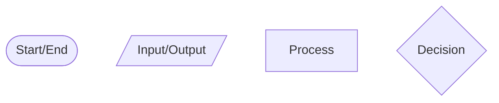
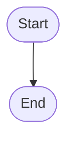
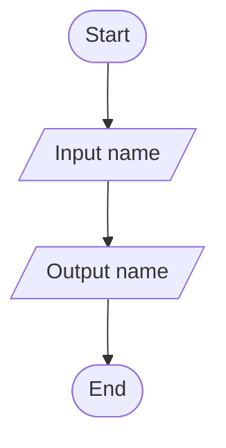
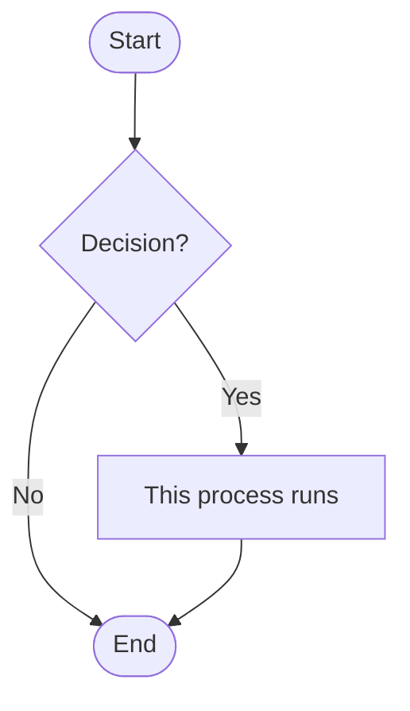
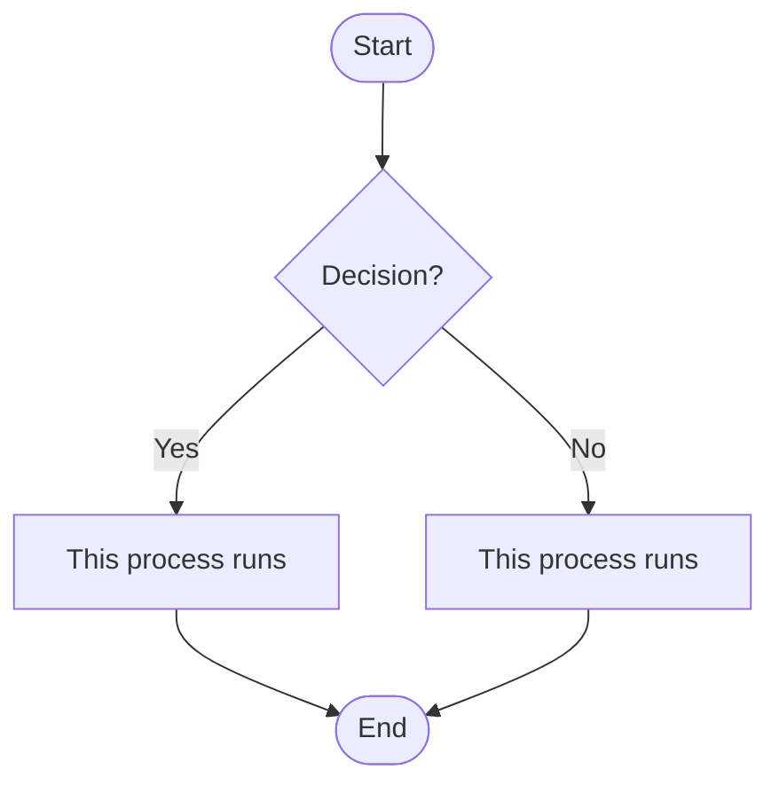
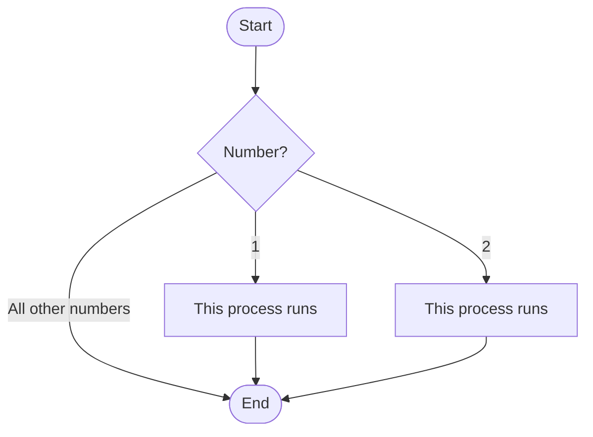
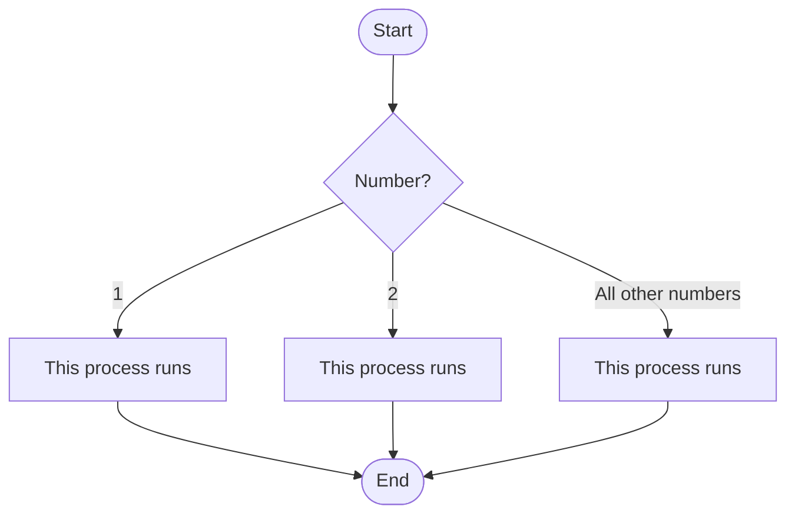
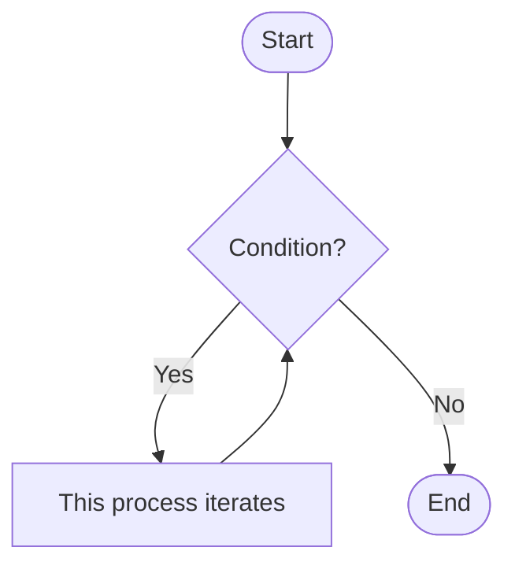

# Flödesschema

- Ett flödesschema är en typ av diagram som representerar ett arbetsflöde eller en process. 
- Ett flödesschema kan beskrivas som en algoritm i diagramform, det vill säga en steg-för-steg-process för att lösa en uppgift.
- Flödesschema visar stegen som noder med olika form och deras ordning genom att koppla ihop noderna med pilar. 
- Ett flödesschema illustrerar en lösningsmodell för ett givet problem. 

## Noder

Ett flödesschema består av olika **Noder** som representerar olika typer av steg i processen. De vanligaste symbolerna är:

## Flöde

**Pilarna** i flödesschemat visar riktningen på flödet mellan noderna.

## Input och Output i flödesschema
Input/Output i flödesschema representeras av en **parallellogram** som används för att visa att programmet tar emot data från användaren eller skriver ut data till användaren.

Exempel på ett flödesschema som illustrerar **Input** och **Output**, flödesschemat visar ett program som tar emot ett namn från användaren och skriver ut det på skärmen:

## Selektion i flödesschema
Selektion i flödesschema representeras av en **decision-nod** som har två eller flera utgångar. Decision-noden används för att visa att programmet kan ta olika vägar beroende på ett villkor. Texten i pilarna 

---
Exempel på ett flödesschema som illustrerar en **if-sats**, om villkoret är sant körs processen:

---
Exempel på ett flödesschema som illustrerar en **if och else-sats**, om villkoret är sant körs den första processen, annars körs den andra processen:

---
Exempel på ett flödesschema som illustrerar en **if och elif-sats**, om villkoret är sant körs den första processen, annars kontrolleras nästa villkor och om det är sant körs den andra processen:

---
Exempel på ett flödesschema som illustrerar en **if, elif och else-sats**, om villkoret är sant körs den första processen, annars kontrolleras nästa villkor och om det är sant körs den andra processen, annars körs den tredje processen:

## Iteration i flödesschema
Iteration i flödesschema representeras av en **loop** som har en utgång som leder tillbaka till en tidigare nod. Loopen används för att visa att programmet kan upprepa vissa steg beroende på ett villkor. Texten i pilarna visar villkoret som avgör om loopen ska fortsätta eller avslutas.

Exempel på ett flödesschema som illustrerar en **loop**, decision-noden utgör en loop då den har en utgång som leder tillbaka till sig själv:

